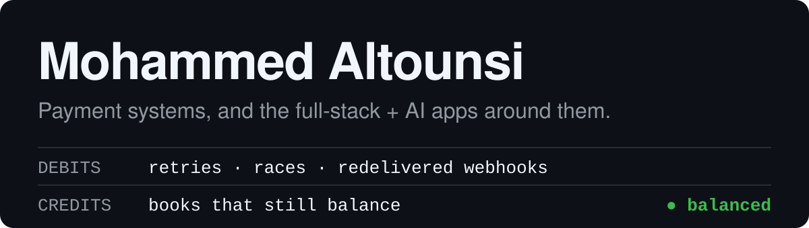

I build web apps with Ruby on Rails and Next.js. Most of my work is payments and
Stripe integrations, plus a couple of tools that use the Anthropic API. Each
project below has a live demo.

### Payments

| Project | What it is | Live |
|---|---|---|
| [rails-refunds-system](https://github.com/MohammedAltounsi/rails-refunds-system) | Stripe refunds in Rails 8. Each refund goes through a state machine, partial refunds are supported, and every money movement is recorded in a double-entry ledger. | [demo](https://rails-refunds-system.onrender.com) |
| [rails-stripe-wallet-ledger-sandbox](https://github.com/MohammedAltounsi/rails-stripe-wallet-ledger-sandbox) | A coffee-shop demo with card payments and a prepaid wallet. Uses Stripe PaymentIntents and signed webhooks, plus a reconciliation check against Stripe. | [demo](https://dallah-coffee.onrender.com) |

### AI tools

| Project | What it is | Live |
|---|---|---|
| [AI-Website-Auditor](https://github.com/MohammedAltounsi/AI-Website-Auditor) | Audits a website from its URL. Pulls the four PageSpeed scores, averages them, and uses Claude to write a list of fixes sorted by severity. | [demo](https://ai-website-auditor-indol.vercel.app) |
| [AI-Code-Reviewer](https://github.com/MohammedAltounsi/AI-Code-Reviewer) | Reviews one file of code, pasted or from a GitHub link. Lists issues by severity with a suggested fix for each, and gives a score out of 100. | [demo](https://ai-code-reviewer-coral-five.vercel.app) |

### Websites and apps

| Project | What it is | Live |
|---|---|---|
| [Complaint-Management-System](https://github.com/MohammedAltounsi/Complaint-Management-System) | Complaint tracking for Saudi online stores, in Arabic. Several stores can use one install, each with its own data. Covers intake, follow-up and monthly reports. | [demo](https://complaints-saas-demo.vercel.app) |
| [Morph-Design-Studio-Website](https://github.com/MohammedAltounsi/Morph-Design-Studio-Website) | Arabic and English website for a design studio. | [demo](https://morph-design-studio.vercel.app) |
| [Premium-Olive-Oil-Illustration-Website](https://github.com/MohammedAltounsi/Premium-Olive-Oil-Illustration-Website) | Arabic and English website for a Saudi olive oil brand, with an illustrated hero and drawings that play as you scroll. | [demo](https://naturaloli-preview.onrender.com) |
| [Heritage-Sweets-Paper-Cut-Illustration-Website](https://github.com/MohammedAltounsi/Heritage-Sweets-Paper-Cut-Illustration-Website) | Arabic-first website for a sweets factory in Jeddah, with paper-cut scenes that move as you scroll. | [demo](https://hijazi-taste-preview.vercel.app) |

### Stack

Ruby on Rails, Next.js, TypeScript, React, PostgreSQL, Tailwind, Stripe, Anthropic API.

### Contact

[LinkedIn](https://www.linkedin.com/in/mohammed-altounsi/) · mhmdaltounsi@gmail.com
